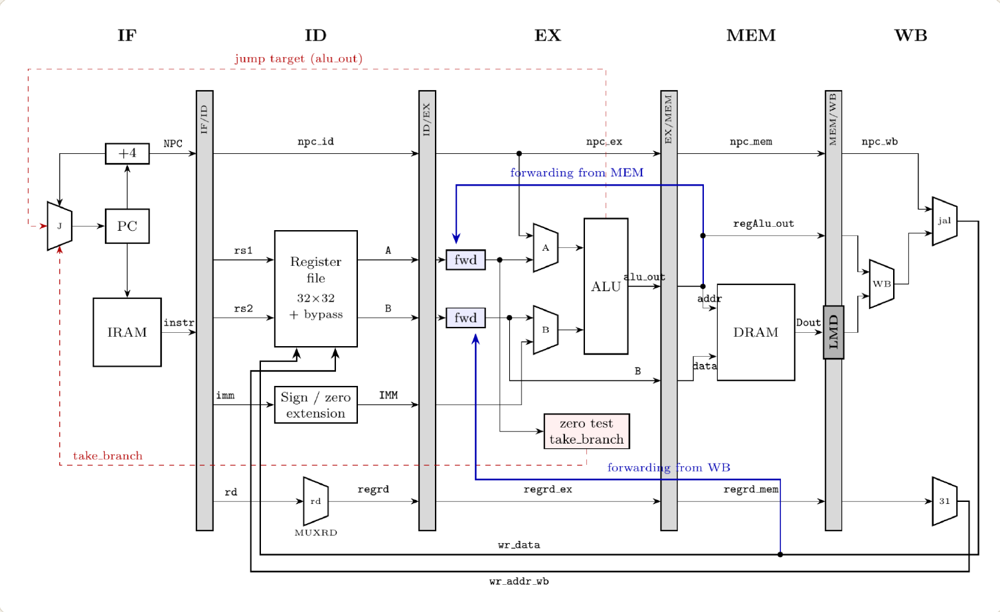
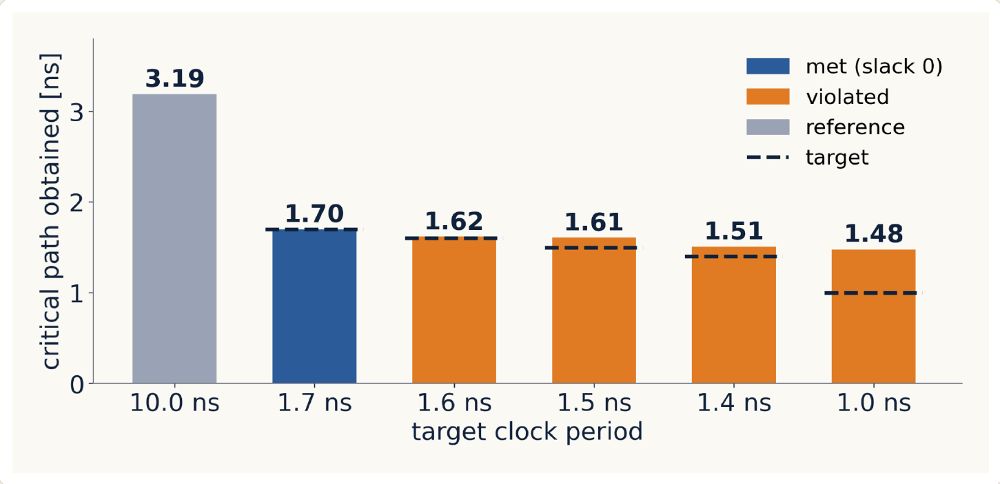
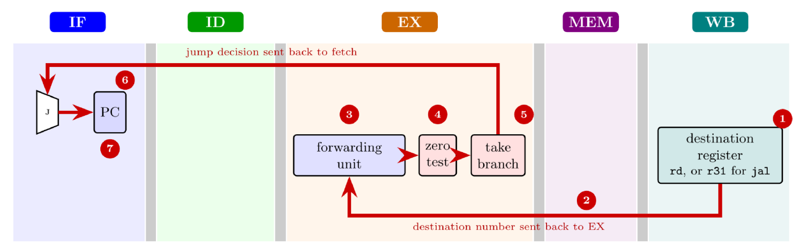
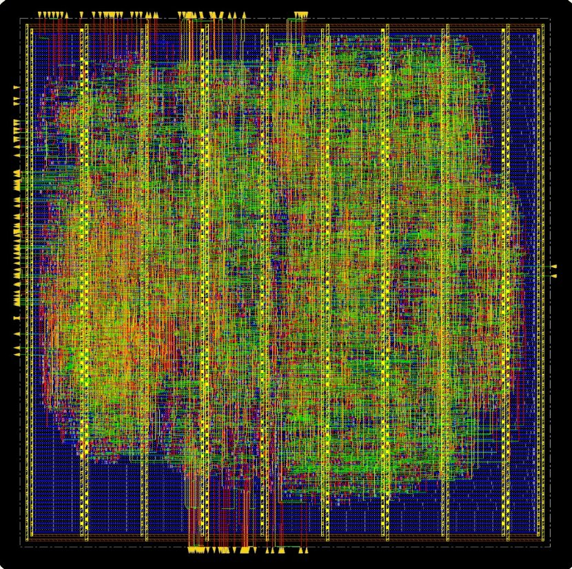
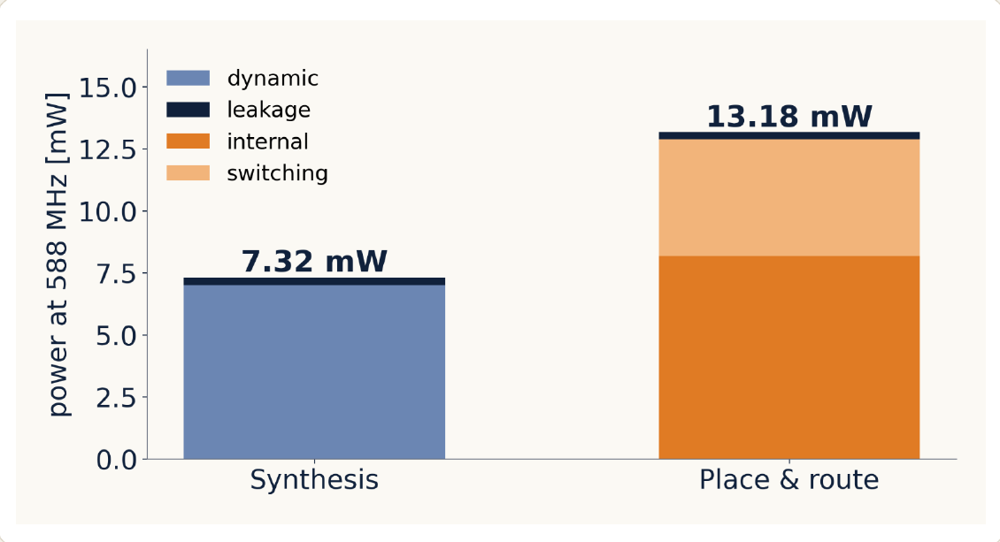
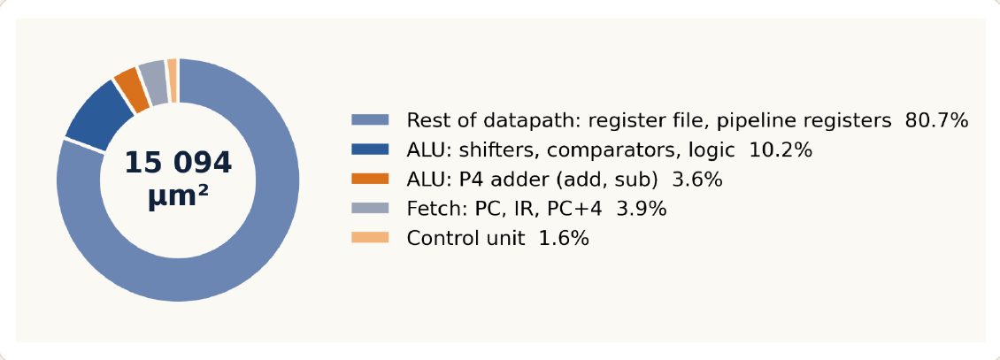

# DLX Microprocessor — from VHDL to Layout

A five-stage pipelined DLX processor with forwarding, 50 instructions and a P4 adder,
written in VHDL, verified in simulation, synthesized and carried through place & route
on the NanGate 45 nm Open Cell Library.  
*Course: Microelectronic Systems — Politecnico di Torino, final project (DLX "pro" version), 2026.*



## Results

| | |
|---|---|
| Instructions | **50** (27 basic + 23 extended) |
| Pipeline | 5 stages, in order, single issue, hardwired control unit |
| Hazards | full forwarding; **1** stall cycle on load-use, **2** cycles on a taken branch/jump |
| Clock | **588 MHz** (1.7 ns) after layout, setup slack +0.165 ns, no hold or DRV violations |
| Area | **15 094 µm²** of cells, die 176 × 175 µm |
| Power | 13.2 mW at 588 MHz after place & route |

## Starting point and what I built

The course provided the package, the top level, the instruction memory, three partial control
units, an empty datapath file, a testbench and the assembler (`dlxasm.pl`, `conv2memory`).
On top of that I designed:

- the **complete pipelined datapath** at RT level;
- the **hardwired control unit**: a 64 × 15 control-word table indexed by the opcode, with the
  ALU operation decoded separately as an enumerated type, and the control word travelling with its
  instruction through three pipeline registers (EX, MEM, WB);
- **hazard handling**: branches resolved in EX with a two-instruction flush, load-use stall,
  forwarding from MEM and WB plus a register-file bypass;
- **23 extra instructions** (signed and unsigned comparisons, arithmetic shift, unsigned
  arithmetic, `lhi`, `jr`, `jalr`) and the **P4 sparse-tree adder** from the labs inside the ALU;
- the **synthesis and place & route scripts**, including clock-tree synthesis.

## Instruction set

| Group | Instructions |
|---|---|
| Basic (27) | `add sub and or xor sll srl sne sle sge` · `addi subi andi ori xori slli srli snei slei sgei` · `lw sw beqz bnez j jal nop` |
| Extended (23) | `seq slt sgt sltu sgtu sleu sgeu` and immediate forms · `sra srai lhi` · `addu subu addui subui` · `jr jalr` |

`jr r31` returns from a `jal` call, and `lhi` + `ori` build any 32-bit constant.

## Hazards and forwarding

Forwarding covers every distance: the ALU result of the previous instruction comes from MEM,
the value being written back comes from WB (MEM has priority because it is more recent), and a
write and a read of the same register in the same cycle go through the register-file bypass.
Register r0 is never forwarded. The only remaining data stall is load-use, which inserts one bubble.

On the `test_stalls` program, forwarding brings the execution from **14 to 9 cycles** compared
with a stall-only pipeline, with identical results.

## Verification

Each feature has its own commented assembly program in [`asm/`](asm), checked in QuestaSim by
examining the register file and the data memory at the end of the run:

| Program | Checks |
|---|---|
| `test_alu`, `test_cmp` | ALU operations, signed comparisons |
| `test_mem` | `sw`, `lw`, negative values |
| `test_jump`, `test_jump2`, `test_jal`, `test_jr` | flushes, r31, calls and returns |
| `test_branch`, `test_loop` | every branch, a loop over memory |
| `test_stalls` | forwarding and load-use stall |
| `test_ext`, `test_lhi` | the extended instructions |
| `test_all` | everything: 48 instructions, all 32 registers |

Every instruction that must be flushed writes r27, so **r27 = 0 at the end proves that all
flushes worked**. The building blocks (ALU, P4 adder, register file, memories, control unit) also
have their own testbenches in [`test_bench/`](test_bench).

```sh
./compile.sh           # compile all VHDL sources in dependency order (QuestaSim)
./build.sh test_all    # assemble asm/test_all.asm, load it into the IRAM and simulate
```

## Synthesis

Synopsys Design Compiler, on control unit + datapath (memories excluded), with the clock period
swept from 10 ns down to 1.0 ns ([`syn/dlx.scr`](syn/dlx.scr), reports in [`syn/reports/`](syn/reports)).
The reference run gives a 3.19 ns critical path; the tightest constraint that is met is
**1.7 ns (588 MHz)**, used for the layout, while over-constraining reaches 1.48 ns.



The **critical path is in the pipeline control**, not in the adder: a value written back in WB is
forwarded to EX, goes through the zero test, decides the branch and selects the next PC, all in
one cycle. A faster adder would not help; the fix would be to compute the forwarding comparisons
one stage earlier, in ID.



**Lesson learned:** the control-word table was first declared as a `signal` with an initial value.
Simulation was correct, but Design Compiler ignores initial values, so every control output was
tied to 0. The reports looked fine because constants were not propagated across the hierarchy;
only in Innovus, after flattening, 1 045 flip-flops (register file included) were removed. The fix
was to declare the table as a constant, and to run `check_design` in every synthesis.

## Place & route

Cadence Innovus ([`pnr/dlx_pnr.tcl`](pnr/dlx_pnr.tcl)): floorplan, power plan, placement,
clock-tree synthesis, routing with setup and hold optimization, then extraction of parasitics and
delays. Final reports: [timing](pnr/dlx_timing_pnr.rpt), [area](pnr/dlx_area_pnr.rpt),
[power](pnr/dlx_power_pnr.rpt).

| Check | Result |
|---|---|
| Setup WNS | +0.165 ns |
| Hold WNS | 0.000 ns |
| Violations, DRV | 0 |
| Cell area | 15 094 µm² |
| Die | 176 × 175 µm |

<p>
  
  
</p>



Power almost doubles after layout (7.3 → 13.2 mW) because of the clock tree and the real wire
loads. The register file and pipeline registers take about 80% of the cell area; the whole ALU
13.8%, of which the P4 adder 3.6%.

## Repository contents

```
000-globals.vhd, a-*.vhd, a.*.vhd   VHDL sources (package, top level, CU, datapath, memories)
a.b-DataPath.core/                   datapath components: register file, ALU, P4 adder, muxes, registers
a-DLX_syn.vhd                        synthesis top level (CU + datapath, memories as ports)
test_bench/                          testbenches
asm/                                 commented test programs
assembler.bin/                       DLX assembler and memory converter (provided by the course)
compile.sh, build.sh, waves.do       simulation flow
syn/                                 Design Compiler script and reports
pnr/                                 Innovus script, constraints and final reports
docs/report.pdf                      full project report (109 pages)
docs/slides.pdf                      presentation
```

Gate-level netlists, SDF and SPEF files are not included because of their size; they are
regenerated by the scripts. The NanGate 45 nm library is not included.

## Possible extensions

Branch decision in ID or a branch history table (2 → 1 or 0 lost cycles), byte and half-word
loads and stores, a multi-cycle Booth multiplier, post-layout simulation with SDF delays, and
realistic input/output delays on the memory interface.

## Author

**Lorenzo Pavone** — Group 25
